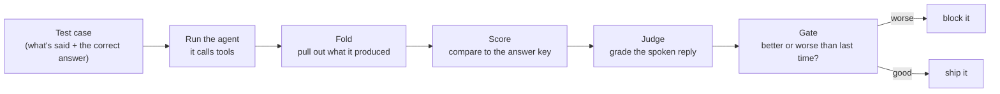

# agent-eval — a report card for voice agents

A voice agent listens to someone talk and then *does things* — transcribes speech,
decides, and calls tools that change real data (a dental chart, a booking). When the
result is wrong, you usually can't tell **which step broke**. This tool runs the
agent on test cases, scores it against a known-correct answer key, and **fails the
build when a new version gets worse** — so you catch mistakes before your users do.

Built for the kind of agent Renfort ships: one that hears a dentist and fills the
patient chart.

> **New here?** This README gets you running. For the deep version — architecture,
> the sample test cases explained, and the roadmap — see **[GUIDE.md](./GUIDE.md)**.

---

## How it works (one picture)



You provide the **left** (a recording + the correct answer). The tool does the rest
and gives you a score, a trace of what the agent did, and a plain-English list of
what went wrong.

---

## You decide what to test and how it's scored

The platform grades nothing on its own — **you** tell it what "correct" means. You do
that with two things:

**1. Test cases** — one `.json` file per scenario. A case has two halves:

- **the input**: what the caller said — either an `audioFile` (real speech) or plain
  `transcriptText` (skip audio and just give the words).
- **the answer key** (`groundTruth`): the correct final result the agent should have
  produced. This is *your* definition of right.

Optional fields turn on extra scoring: `referenceTranscript` (the exact words, so we
can grade speech-to-text), `expectedCalls` (which tools should fire, in order), and
`reply_facts` (facts the spoken reply must contain). See `demo/cases/*.json` — each has
a `_readme` explaining every field.

**2. An adapter** — a small code file that says how to run *your* agent and how to
turn its answer into a 0–100% score. This is where you choose the metrics, the rules
(e.g. "a pocket depth within 1 mm still counts"), and their weights. Copy
`adapters/sample-agent.ts` — it's a commented template.

### The four scores

Every case is graded on up to four things, so a failure tells you **which step broke**:

| Score | Question it answers | Comes from |
|---|---|---|
| **Heard** | Did speech-to-text get the words right? | `referenceTranscript` |
| **Tools** | Did it call the right tools, in the right order? | `expectedCalls` |
| **Correct** | Did the final result match the answer key? | `groundTruth` + your `score()` |
| **Reply** | Is the spoken reply faithful (says the facts, invents nothing, reads cleanly)? | `reply_facts`, graded by an LLM judge |

A score column shows `–` when a case doesn't use it (dental has no spoken reply, so
its Reply is blank; and the judge step is simply skipped when there's no reply to
grade — that's expected, not a failure).

**Not limited to four.** "Correct" isn't one number — it's however many outcome metrics
your adapter defines. Score teeth *and* bleeding *and* recession, and each gets its own
column in the table and its own bar in the report. They all combine, with Heard, Tools
and Reply, into one **composite** (you set the weights; the judged Reply's share is
`judgeWeight`). The **gate** compares that composite to your previous run and fails the
build if it dropped.

---

## File structure

```
platform/src/     the ENGINE (domain-agnostic — you never edit this):
                  run → fold → score → judge → gate, the CLI, the HTML report

adapters/         YOUR agents go here
  sample-agent.ts   copy-me template — a tiny agent with step-by-step comments
  sample-case.json  a runnable example test for it
  index.ts          lists which of your adapters are turned on

demo/             WORKING EXAMPLES to read and learn from
  adapters/
    dental/         charts teeth from dictation (no spoken reply)
      adapter.ts      the adapter: runs the agent + the scoring rules
      mock.ts         an offline fake agent (so it runs with no API key)
      score.test.ts   unit tests for the scorer
    receptionist/   books/reschedules + a spoken reply that gets judged
      adapter.ts
      mock.ts
    index.ts        registers the two example adapters
  cases/          example tests — one .json each = what's said + the correct answer
  prompts/        good-vs-weak system prompts for the real-agent demo
  gen-audio.ts    turns case transcripts into real speech (text-to-speech)

results/          the tool writes these — grouped by adapter:
  <adapter>/<run>/report.html    ← open this
  <adapter>/<run>/report.json    scores as data    ·  gate.json  pass/fail + why
  <adapter>/<run>/cases/<id>/…   per case: events, produced, segments, score, judge, trace
  index.json                     history of every run
```

Rule of thumb: **you touch `adapters/` (your agent) and your case files; the tool
fills `results/`.** The whole `demo/` folder is just examples — safe to delete.

---

## Setup & run (30 seconds, no API key)

```bash
npm install
npm test                                                    # checks the grader itself

# EXAMPLE agent: a good run, then a broken one — watch the gate catch the regression
npm run eval -- run --adapter receptionist --provider mock       --name smoke
npm run eval -- run --adapter receptionist --provider mock-bug   # → "smoke v2"
```

Every run prints a clean table and writes **`results/receptionist/smoke-v2/report.html`**
— open it in a browser to see the flow, the scores, and what to fix.

Run the **sample template agent** (your own folder) end to end:

```bash
npm run eval -- run --cases adapters/sample-case.json --adapter sample
```

### The two example agents

| domain | what the agent does | what we catch |
|---|---|---|
| **dental** | hears pocket depths, charts each tooth | mis-heard numbers, wrong tooth, wrong order |
| **receptionist** | books/reschedules + says a spoken reply | wrong slot, invented info, bad wording, wrong tool order |

Each runs offline (`--provider mock`), broken-on-purpose (`mock-bug`), or with a
**real** LLM agent (`--provider openai` / `anthropic`, needs a key).

### Commands

| command | what it does |
|---|---|
| `run --adapter <d> [--cases <path>] [--provider …] [--stt mock\|openai] [--name x]` | run, score, gate, write the HTML report |
| `score --run "<name>"` | **re-score** saved runs with the current rules (no inference) |
| `html --run "<name>"` | (re)write the HTML report |
| `runs` | list past runs + pass/fail |
| `show --run "<name>" --case <id>` | one case in the terminal |
| `gate --baseline "<a>" --candidate "<b>"` | compare two runs (exit 1 if worse) |
| `cases` / `lint` | list / validate your test cases |

`--cases` defaults to `demo/cases`; point it at your own folder or a single `.json`.

**Run names & the gate.** A run is labelled `<name> v<N>` — `<name>` is your `--name`
(or the adapter name if you omit it), and `<N>` counts how many runs of that name
already exist. The **gate always compares to the previous run of the same adapter**
(not the label), so a run is lined up correctly whether or not you named it. Want
clean `v1 → v2` labels? Pass the **same** `--name` to both runs. Want to reset?
`npm run clean` (wipes `results/`, `.cache/`, and generated audio).

---

## Bring your own agent — a beginner walkthrough

You never touch the engine. You add two kinds of files: **one adapter** (how to run
and grade your agent) and **some cases** (your tests). Here's the whole thing, in
order.

**Step 1 — copy the template.** Everything you write lives in the `adapters/` folder.

```bash
cp adapters/sample-agent.ts adapters/myagent.ts
```

**Step 2 — point `run()` at your agent.** Open `adapters/myagent.ts`. Change `name`
to `"myagent"`, then in `run()` replace the toy parser with a call to your real agent
(Vapi / Retell / an LLM / whatever). You get the transcript in; you return the list of
tool calls it made. The comments in the file mark exactly where.

**Step 3 — say what "correct" means in `score()`.** This is where your scores live.
Return one entry in the `metrics` map for **each thing you want measured** — as many as
you like — each a 0–1 value with a weight (weights add up to 1):

```ts
metrics: {
  text: { value: textOk, total: 1, correct: textOk },
  time: { value: timeOk, total: 1, correct: timeOk },
},
weights: { text: 0.5, time: 0.5 },     // ← add/adjust these to add more scores
```

Every metric you add here becomes **its own column** in the table and **its own bar**
in the HTML report. (Want a spoken reply graded by an LLM too? Fill in `judgeSpec()` —
see the receptionist example.)

**Step 4 — turn your adapter on.** Add one import line to `adapters/index.ts`:

```ts
import "./myagent.ts";
```

**Step 5 — write a test case.** A case is a `.json` file: what was said + the correct
answer. Copy `adapters/sample-case.json` (or `demo/cases/*.json`) and edit it. The
minimum is: `adapter` (must match your `name`), an input (`transcriptText` or
`audioFile`), and `groundTruth` (the right answer).

**Step 6 — run it.**

```bash
npm run eval -- lint --cases adapters/myagent-cases            # catch bad cases first
npm run eval -- run  --adapter myagent --cases adapters/myagent-cases   # run + score + gate
```

It prints a table and writes `results/myagent/<run>/report.html` — open that in a
browser. Run it again after any change; the gate tells you if you got worse.

That's the whole loop. The engine, scoring math, judge, gate and report never change —
you only ever edit `adapters/`.

---

## Fully real, end to end (with your keys)

The real pipeline is: **ElevenLabs speaks → OpenAI transcribes → a real LLM agent
acts → we score it.**

```bash
cp .env.example .env               # then add your keys to .env (see note below)
```

Each domain has a **good** prompt (passes) and a **weak** one (fails, gate catches it).
Run the good one first (it's the baseline), then the weak one:

```bash
npm run eval:real:dental           # v1 good  → charts correctly → PASSES (~100%)
npm run eval:real:dental:weak      # v2 weak  → adds a 2mm margin → charts wrong → gate FAILS it

npm run eval:real:receptionist       # v1 good → books + speaks → PASSES
npm run eval:real:receptionist:weak  # v2 weak → invents an insurance line → judge catches it → gate FAILS
```

**Keys.** `OPENAI_API_KEY` alone is enough — it covers speech-to-text, the agent, *and*
the text-to-speech used to make the demo audio. `ELEVENLABS_API_KEY` is optional (nicer
voice); if you add it, make sure it's the real key — ElevenLabs keys start with `sk_`,
not the key *ID*. If the ElevenLabs key is missing or rejected, audio generation falls
back to OpenAI automatically.

> Do **not** paste API keys into chat or commit them. They live only in `.env`, which
> is git-ignored.

Mistakes here are *real*, not scripted: `demo/prompts/dental-good.txt` vs
`demo/prompts/dental-weak.txt` are two prompts for the same real agent. Keep the offline
mock for fast, free, deterministic testing; use the real path for the demo.

**Hear the agent talk.** On any real run (`--provider openai`/`anthropic`) the agent's
spoken reply is **automatically saved** as `reply.mp3` next to that case's results:

```
results/receptionist/<run>/cases/<id>/reply.mp3     # play it back
```

(Offline `mock` runs don't; add `--speak` to force it there too.) It's playback only —
the reply is still *judged as text*, so scores don't change. Cases with no spoken reply
(dental) are skipped, and it no-ops if no TTS key is set.

---

## Why the scores are trustworthy

The agent (an LLM) is random; **the grader is not** — it's plain code comparing to a
fixed answer key. `--repeat N` measures how much the agent wobbles, and the LLM judge
must **quote verbatim evidence** that code then verifies. The measuring never trusts
the thing being measured.

---

See **[GUIDE.md](./GUIDE.md)** for the architecture, the sample test cases explained in
detail, the phase-2 roadmap (improvement loop, Jev, MCP), and known limitations.
</content>
</invoke>